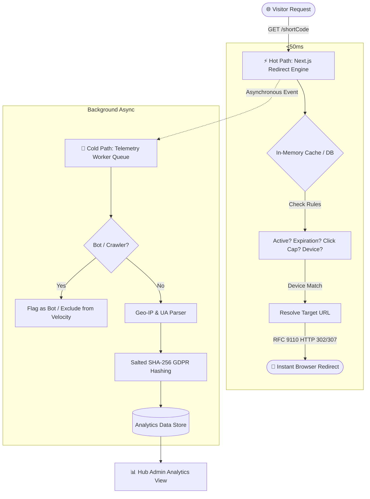

<div align="center">

# ⚡ LinkPulse
### Collaborative Link Hubs, Sub-50ms Smart Redirection & Privacy-Preserving Telemetry

[](https://nextjs.org/)
[](https://react.dev/)
[](https://www.typescriptlang.org/)
[](https://tailwindcss.com/)
[](LICENSE)

**[🌐 Live Demo](https://github.com/joshigaurav542-design/CodeMaxxing-LinkPulse)** • **[📖 Documentation](#-getting-started)** • **[🚀 Architecture](#-architecture--hotcold-path-isolation)** • **[📸 Screenshots](#-screenshots--visual-tour)**

</div>

---

## 📌 Problem Statement

Traditional URL shorteners and link-in-bio services suffer from major architectural and operational bottlenecks:

1. **Unorganized Link Clutter**: Thousands of links live in a single flat list without organizational boundaries. Marketing, engineering, and product teams cannot isolate projects, leading to accidental deletions and administrative gridlock.
2. **Synchronous Redirection Latency**: Conventional platforms record analytics and parse request telemetry synchronously during the redirect handshake, introducing **200ms–500ms latency spikes** for end users.
3. **Absence of Role-Based Collaboration**: Standard link shorteners operate on an all-or-nothing permission model. Teams cannot securely invite contributors, share curated collections with clients, or safely allow community participation.
4. **Data Privacy Liabilities**: Raw IP addresses and personally identifiable data are frequently logged without sanitization, creating severe GDPR and privacy compliance risks.
5. **No Built-in Governance or Abuse Prevention**: Missing SSRF validation, unmonitored redirect loops, expired dead links, and unmanaged link rot damage brand credibility and campaign ROI.

---

## 💡 The Solution: LinkPulse

**LinkPulse** re-engineers link management from the ground up:

- **Collaborative Link Hubs**: Micro-workspaces structured around campaigns, teams, or topics. Each hub features custom slugs (`/hub/[slug]`), dedicated members, and role-based access control (Admin, Contributor, Visitor).
- **Sub-50ms Hot-Path Redirection**: High-speed, non-blocking redirect pipeline with strict separation of the **Hot Path** (HTTP 302/307 redirects) from the **Cold Path** (asynchronous telemetry queues).
- **In-Hub Management & Bulk CSV Import**: Both link creation and batch CSV imports are performed directly inside hubs, guaranteeing automatic ownership attribution and clean link isolation.
- **Privacy-First Hub Analytics**: Salting and hashing visitor fingerprints (SHA-256) daily with RFC-compliant bot/crawler filtering. Hub telemetry is scoped exclusively to authorized Hub Admins.
- **Smart Rule-Based Routing**: Intelligent device targeting (iOS, Android, Desktop), click-cap thresholds, schedule-based expirations, and password gates.

---

## ✨ Features

### 🏢 1. Collaborative Link Hubs
- **Topic-Based Hubs**: Organize links into hubs (Technology, Hackathons, Marketing, Developer Tools, etc.) with custom accent colors and public/private visibility.
- **Role-Based Access Control (RBAC)**:
  - 👑 **Hub Admin**: Complete control to manage hub settings, add/remove members, toggle link statuses, delete links, and inspect analytics.
  - 👤 **Contributor**: Add new links and bulk import links directly into authorized hubs.
  - 🌐 **Visitor**: Browse public hub collections and request User Access in a single click.
- **Share Hub Studio**: One-click share modal generating direct links, QR codes, and custom share messages.

### 📥 2. In-Hub Bulk CSV Import & Link Creation
- **Scoped In-Hub Operations**: Create individual links or upload entire CSV datasets directly from within a link hub.
- **PapaParse CSV Streaming**: Instant client-side verification, duplicate alias detection, and protocol validation with error reporting.
- **Immediate State Synchronization**: Automatically updates hub link counts, member activity, and telemetry charts upon import.

### ⚡ 3. High-Speed Redirection Engine
- **Sub-50ms Response Time**: Non-blocking redirect resolution with zero database lag on the hot path.
- **Smart Device Routing**: Route visitors to designated URLs based on operating system (iOS App Store, Android Play Store, Desktop Web).
- **Click-Cap Limits & Expiration**: Automatically deactivate links after reaching target clicks or calendar deadlines.
- **Password Protection**: Glassmorphic challenge screen for confidential or exclusive links.
- **Branded Fallback Screens**: Clean HTTP 410 (Expired/Capped) and HTTP 403 (Suspended) error states.

### 📊 4. Hub-Scoped Analytics & Telemetry
- **Admin-Only Hub Visibility**: Analytics tabs are embedded inside individual hubs for hub administrators.
- **Interactive Recharts Visualizations**:
  - Click velocity area charts.
  - Device distribution donuts (Desktop, Mobile, Tablet).
  - Geographic footprint (Countries & Cities).
  - Top referrers and operating system breakdown.
- **Privacy-Safe Fingerprinting**: GDPR-compliant salted SHA-256 daily hashes—raw IP addresses are never permanently stored.
- **Automated Bot & Crawler Filtering**: Powered by `isbot` and `ua-parser-js` to protect analytics integrity.

### 📱 5. QR Code Studio & Link-in-Bio Micro-Pages
- **Dynamic QR Codes**: Generate high-resolution, branded QR codes with custom foreground/background colors and download as PNG/SVG.
- **Mobile-First Bio Pages (`/bio/[slug]`)**: Beautiful glassmorphic public landing pages displaying curated link collections.

### 🛡️ 6. Security & Governance Console
- **OWASP Anti-SSRF Validation**: Pre-publish sanitization blocking internal IP ranges and private network targets.
- **Domain Blocklist**: System-wide protection against known malicious domains.
- **Instant Emergency Takedowns**: Immediately invalidate compromised links while preserving audit logs.
- **Personal Activity Feed**: Comprehensive audit log under "Your Profile" tracking every creation, edit, and access request.

---

## 🏛️ Architecture & Hot/Cold Path Isolation



---

## 🛠️ Tech Stack

| Layer | Technology | Purpose |
|---|---|---|
| **Framework** | [Next.js 16.4](https://nextjs.org/) (App Router, Turbopack) | Server-side rendering, API routes, hot-path routing |
| **UI Library** | [React 19](https://react.dev/) & [TypeScript 5](https://www.typescriptlang.org/) | Type-safe interactive user interface |
| **Styling** | [Tailwind CSS v4](https://tailwindcss.com/) | Modern design, dark/light theme, glassmorphism |
| **Charts** | [Recharts](https://recharts.org/) | Interactive telemetry area & pie charts |
| **Data Engine** | Node 22/24 Native `node:sqlite` / [Supabase](https://supabase.com/) | ACID transactions, WAL mode, persistence |
| **CSV Engine** | [PapaParse](https://www.papaparse.com/) | In-browser CSV streaming and validation |
| **QR Generation**| [node-qrcode](https://github.com/soldair/node-qrcode) | Canvas-rendered vector and raster QR codes |
| **Bot Detection**| [isbot](https://github.com/omrilotan/isbot) & [ua-parser-js](https://github.com/faisalman/ua-parser-js) | Crawler classification and telemetry parsing |
| **Icons** | [Lucide React](https://lucide.dev/) | Clean, accessible iconography |

---

## 📸 Screenshots & Visual Tour

> 💡 *Save your captured screenshots inside the `/screenshots/` folder matching the filenames below.*

### 1. Link Hubs Workspace Directory
*Categorized hubs with real-time counters, tag filters, search, and role indicators.*


### 2. Inside a Link Hub (Hub Detail & In-Hub Actions)
*Dedicated workspace showing hub hero banner, member list, and in-hub **Bulk Import** & **Create Link** actions.*


### 3. Hub Analytics Dashboard (Admin Only)
*Real-time click velocity charts, device distribution, geographic breakdown, and bot telemetry.*


### 4. In-Hub Bulk CSV Import
*Streamed CSV parser verifying column syntax, custom aliases, and destination URLs before batch creation.*


### 5. Smart Link Creation Wizard
*Create links with custom aliases, device-specific targeting (iOS/Android/Web), click caps, and password gates.*


### 6. Interactive QR Code Studio
*Custom branded QR code generation with custom accent colors and instant PNG download.*


### 7. User Profile & Audit Activity Feed
*Audit feed tracking user actions, creation events, status toggles, and role badges.*


### 8. Public Link-in-Bio Landing Page
*Responsive mobile-first micro-page showcasing curated links for a creator or organization.*


---

## 🏃 Getting Started

### Prerequisites

- **Node.js**: `v22.5.0` or higher (recommended: Node 22/24)
- **Package Manager**: `npm`, `pnpm`, or `yarn`
- **Git**

### Installation

1. **Clone the Repository**:
   ```bash
   git clone https://github.com/joshigaurav542-design/CodeMaxxing-LinkPulse.git
   cd CodeMaxxing-LinkPulse
   ```

2. **Install Dependencies**:
   ```bash
   npm install
   ```

3. **Configure Environment Variables**:
   Copy `.env.example` to `.env`:
   ```bash
   cp .env.example .env
   ```

   *Default `.env` configuration:*
   ```env
   DATABASE_URL="file:./dev.db"
   NODE_ENV="development"
   NEXT_PUBLIC_APP_URL="http://localhost:3000"
   JWT_SECRET="linkpulse-secret-jwt-key-2026-codemaxxing"
   ```

4. **Start the Development Server**:
   ```bash
   npm run dev
   ```

5. **Open in Browser**:
   Navigate to [http://localhost:3000](http://localhost:3000).

---

## 🧪 Demo Scenarios to Test Live

| Feature | Sample URL / Action | Expected Behavior |
|---|---|---|
| **Standard Redirect** | `http://localhost:3000/techgeeks` | Sub-50ms instant redirect to external destination |
| **Device Smart Routing** | `http://localhost:3000/get-app` | Dynamic routing based on User-Agent (iOS vs Android vs Desktop) |
| **Password Protection** | `http://localhost:3000/secret-pitch` | Prompts for password (password: `codemaxxing`) |
| **Click-Capped Link** | `http://localhost:3000/flash-90off` | Enforces 100-click ceiling with HTTP 410 fallback screen |
| **Expired Link** | `http://localhost:3000/early-bird` | Shows branded HTTP 410 Gone expiration screen |
| **Link-in-Bio Page** | `http://localhost:3000/bio/codemaxxing` | Glassmorphic mobile-friendly profile page |
| **In-Hub Bulk Import** | Open any Hub ➡️ Click **Bulk Import** | Upload `bulk_import_sample.csv` to batch import into that hub |

---

## 🐳 Docker Deployment

You can containerize and run LinkPulse using Docker:

```bash
# Build the Docker image
docker build -t linkpulse:latest .

# Run container on port 3000
docker run -p 3000:3000 --env-file .env linkpulse:latest
```

Or using Docker Compose:
```bash
docker-compose up -d
```

---

## 👥 Team CodeMaxxing

- **Gaurav Joshi** ([@joshigaurav542-design](https://github.com/joshigaurav542-design)) - *Project Lead & Architecture*
- **Ansh Ahlawat**
- **Anubhav Chand**
- **Dhruvansh Chandola**
- **Kushi Mathela**

*Graphic Era Hill University (GEHU)*

---

## 📄 License

This project is licensed under the [MIT License](LICENSE).
